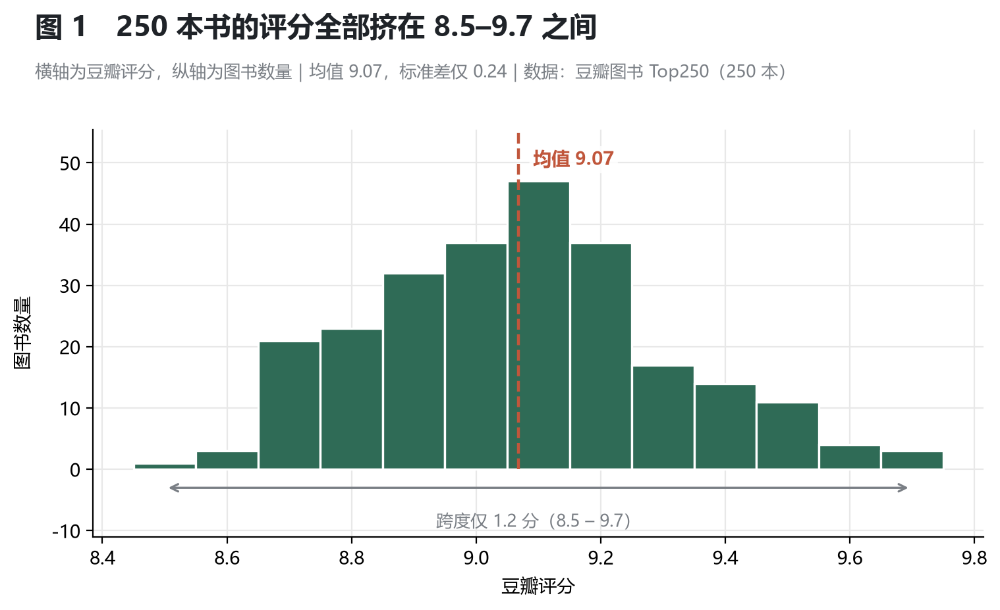
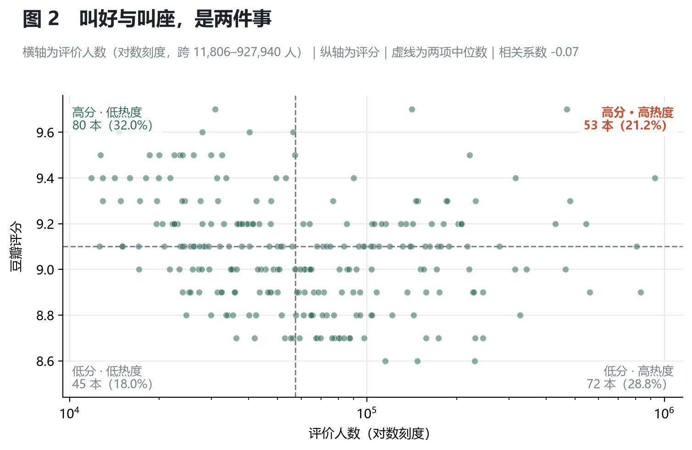
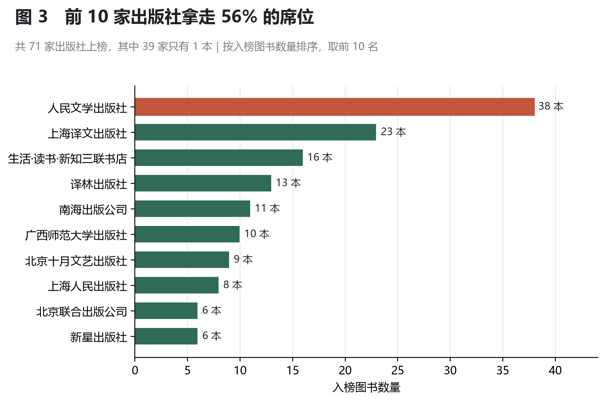
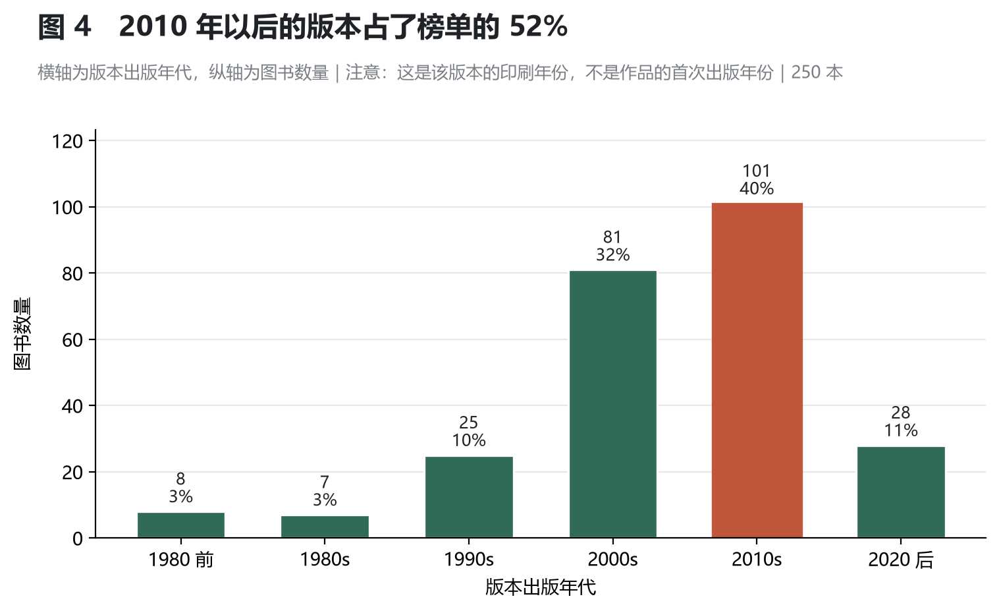

<!--
  图片占位说明（本段注释不会显示在页面上）

  本页共 4 张图，均使用相对路径引用仓库 figures/ 目录下的文件：
      figures/fig1_评分分布.png      → 图 1 评分分布
      figures/fig2_口碑与热度.png    → 图 2 口碑与热度
      figures/fig3_出版社集中度.png  → 图 3 出版社集中度
      figures/fig4_出版年份分布.png  → 图 4 出版年份分布

  替换图片时保持文件名与路径不变，直接覆盖文件即可，正文无需改动。
  若图片未能显示，检查 figures/ 目录是否已随仓库一起上传（区分大小写）。
-->

# 豆瓣图书 Top250 榜单数据分析

用 250 本书的评分、评价人数、出版社和版本年份，回答一个问题：**这份榜单到底是怎么构成的。**

榜单每天被人翻，但它只给出排名，不解释构成——为什么有的书评分更高却排在后面？哪些出版社在榜上反复出现？榜上的书到底有多"老"？这个项目用一次完整的数据分析流程（采集 → 清洗 → 探索 → 可视化 → 结论）把这几个问题拆开来看。

| 数据规模 | 字段 | 采集请求 | 分析维度 |
| :---: | :---: | :---: | :---: |
| 250 本图书 | 11 → 15 列 | 10 次 | 评分 / 热度 / 出版社 / 年份 |

---

## 一分钟结论

| # | 结论 | 一句话依据 |
| :--- | :--- | :--- |
| 1 | 榜内评分几乎没有区分度 | 250 本全部落在 8.5–9.7，标准差仅 0.24 |
| 2 | 口碑与热度是两条独立的赛道 | 评分与评价人数相关系数 −0.07，两者兼得者仅 21.2% |
| 3 | 榜单席位集中在少数出版社 | 71 家上榜，前 10 家占 56%；第一名一家 38 本 |
| 4 | 年份反映的是版本，不是作品 | 84% 为 2000 年后的版本，不能读成"榜单偏爱新书" |

---

## 目录

1. [项目概述](#1-项目概述)
2. [数据源与数据采集方案](#2-数据源与数据采集方案)
3. [数据预处理与数据清洗](#3-数据预处理与数据清洗)
4. [探索性数据分析与图表说明](#4-探索性数据分析与图表说明)
5. [数据分析结论与项目价值](#5-数据分析结论与项目价值)
6. [项目总结、局限性、后续优化方向](#6-项目总结局限性后续优化方向)

---

## 1. 项目概述

### 1.1 项目背景

豆瓣图书 Top250 是一个长期存在、被广泛引用的书单，但它只呈现一个结果：第几名是哪本书。而真正影响"一本书能不能进榜"的因素，榜单本身不会告诉读者。

这个项目从三个具体疑问出发：

- **评分能不能用来挑书**——如果 250 本书的分数都差不多，那分数就不是决策依据；
- **哪些出版社在榜上反复出现**——榜单是纯读者投票的结果，还是有供给侧的力量；
- **榜上的书有多"老"**——是经典老书为主，还是近年新版本为主。

### 1.2 项目目标

| 目标 | 具体要求 |
| :--- | :--- |
| 描述 | 摸清 250 本书的评分、热度、价格、年份、出版社的基本分布 |
| 关联 | 检验"评分高是否等于看的人多"这一常见假设 |
| 归因 | 从出版社与年份两个角度，解释榜单的构成特征 |
| 工程 | 走完一条可复现的链路：采集 → 清洗 → 分析 → 可视化 |

项目定位为**描述性分析**，只使用常规统计与分组对比，不涉及建模与预测。

### 1.3 分析流程

| 阶段 | 做什么 | 工具 | 产出 |
| :--- | :--- | :--- | :--- |
| ① 数据采集 | 请求 10 个列表页，解析 11 个字段 | requests + BeautifulSoup | `data/books_raw_*.csv`、`html_cache/` |
| ② 数据清洗 | 去重、缺失处理、格式与类型转换 | pandas | `data/books_clean_*.csv` |
| ③ EDA 探索 | 描述统计、分组对比、相关性检验 | pandas | 终端统计结果 |
| ④ 可视化 | 4 张成品图 | matplotlib | `figures/fig1–fig4` |
| ⑤ 结论输出 | 结论、局限性、优化方向 | Markdown | 本页 |

两个设计上的取舍：

- **采集与解析分离**：原始 HTML 全部缓存到 `html_cache/`，解析规则改了可以离线重跑，不重复请求对方服务器。
- **清洗规则可追溯**：原始文件 `books_raw.csv` 永不覆盖，所有清洗动作都在新文件上完成，任何一个数值都能回溯到原始文本。

### 1.4 技术栈

| 环节 | 工具 | 版本 | 用途 |
| :--- | :--- | :--- | :--- |
| 采集 | requests | 2.34.2 | 发起 HTTP 请求、维持会话 |
| 解析 | BeautifulSoup4 + lxml | 4.15.0 / 6.1.3 | 解析 HTML，提取字段 |
| 清洗与分析 | pandas | 3.0.6 | 去重、缺失处理、类型转换、分组统计 |
| 可视化 | matplotlib | 3.11.2 | 绘制 4 张静态图 |

运行环境 Python 3.13。

### 1.5 目录结构与运行方式

```
douban-top250-portfolio/
├── index.html                  首页：四图与结论（GitHub Pages 入口）
├── project.html                项目背景与目标
├── dashboard.html              六图可视化看板
├── report.html                 本页：完整分析报告
├── report.md                   本页的 Markdown 源文件
├── _config.yml                 Pages 配置
├── README.md                   仓库简介
├── requirements.txt            依赖清单
├── spider_top250.py            ① 采集：输出 data/books_raw_*.csv 与 html_cache/
├── clean_and_eda.py            ② 清洗 + EDA：输出 data/books_clean_*.csv 与 figures_eda/
├── visualize_basic.py          ③ 可视化：输出 figures/fig1–fig4
├── data/
│   ├── books_raw_20261023.csv      原始数据（250 × 11，未做任何修改）
│   └── books_clean_20261023.csv    清洗后数据（250 × 15，分析用）
└── figures/
    ├── fig1_评分分布.png
    ├── fig2_口碑与热度.png
    ├── fig3_出版社集中度.png
    └── fig4_出版年份分布.png
```

```bash
pip install -r requirements.txt

python spider_top250.py       # 采集，约需 1 分钟（含 3–5 秒随机延时）
python clean_and_eda.py       # 清洗 + EDA，终端会打印全部统计结果
python visualize_basic.py     # 生成 4 张图到 figures/
```

> `spider_top250.py` 会先读取 `html_cache/`，缓存命中时不发任何网络请求。仓库未包含缓存文件，首次运行需联网；之后重跑可离线完成。

---

## 2. 数据源与数据采集方案

### 2.1 数据源

| 项目 | 说明 |
| :--- | :--- |
| 来源 | 豆瓣图书 Top250 榜单公开页面 `book.douban.com/top250` |
| 规模 | 共 10 页，每页 25 条，合计 250 条记录 |
| 采集时间 | 2026 年 10 月 23 日 |
| 采集范围 | 仅列表页可见的字段，**不进入图书详情页** |
| 用途 | 个人学习与作品展示，不用于商业用途 |

### 2.2 采集字段

最终采集 11 个字段（比最初设计多 1 个 `info_raw`，原因见 2.4）：

| 字段 | 含义 | 页面位置 | 示例 |
| :--- | :--- | :--- | :--- |
| `rank` | 排名 | 页面无直接元素，由分页偏移推算 | `1` |
| `book_name` | 书名 | `div.pl2 > a` 的 title 属性 | `红楼梦` |
| `author_raw` | 作者信息（原始） | `p.pl` 文本首段 | `(清)曹雪芹` |
| `publisher` | 出版社 | `p.pl` 文本倒数第 3 段 | `人民文学出版社` |
| `publish_date` | 出版日期 | `p.pl` 文本倒数第 2 段 | `1982-3` |
| `price` | 定价 | `p.pl` 文本最后 1 段 | `59.70元` |
| `rating` | 豆瓣评分 | `.rating_nums` | `9.7` |
| `rating_count` | 评价人数 | `.star .pl` | `(470424人评价)` |
| `quote` | 一句话短评 | `.quote .inq` | `都云作者痴，谁解其中味？` |
| `url` | 详情页链接 | `a.nbg` 的 href | `book.douban.com/subject/1007305/` |
| `info_raw` | 出版信息原文 | `p.pl` 完整文本 | `(清)曹雪芹 / 人民文学出版社 / 1982-3 / 59.70元` |

### 2.3 采集实现

整体只有 40 余行有效代码，四个要点：

- **翻页参数**：`?start=0,25,...,225`，共 10 次请求；
- **会话复用**：用 `requests.Session()` 复用连接，避免每次重新握手；
- **页面缓存**：每页 HTML 先落盘到 `html_cache/`，再解析。调试解析逻辑时走本地文件，不产生网络请求；
- **随机延时**：每页之间 `random.uniform(3, 5)` 秒，并设置 10 秒超时。

### 2.4 页面结构里的三个坑

写代码前先抓了一页下来验证结构，避免按"想当然"的选择器写。实测发现三处与预期不符：

| 坑 | 实际情况 | 处理方式 |
| :--- | :--- | :--- |
| **没有排名元素** | 页面上找不到编号，`em`、`.pic` 都是空的 | `rank = start + 页内序号 + 1` |
| **`p.pl` 段数不固定** | 第 1 页 25 条中，4 段 10 条、5 段 14 条、6 段 1 条 | 不按段数 if-else，改用"日期锚点"定位 |
| **价格不一定带"元"** | `68.00` 与 `59.70元` 同时存在 | 正则提取数字，不依赖单位 |

第二点最容易出错：多出来的段可能是**译者**（`作者 / 译者 / 出版社 / 日期 / 价格`），也可能是**套装书双价**（`53.00元/68.00元` 里的斜杠）。最初按"倒数第 N 段"切分，导致 3 条记录字段错位（详见 3.4）。

最终方案是**以日期为锚点**——日期是整串里唯一具备强格式特征的字段：

```python
DATE_RE = re.compile(r"^\d{4}(\s*[-/年]\s*\d{1,2}\s*月?)?(\s*[-/年]\s*\d{1,2}\s*日?)?$")

parts = [p.strip() for p in info_raw.split("/") if p.strip()]

# 从后往前找第一个形如日期的段，作为锚点
date_idx = -1
for idx in range(len(parts) - 1, -1, -1):
    if DATE_RE.match(parts[idx]):
        date_idx = idx
        break

if date_idx >= 0:
    item["publish_date"] = parts[date_idx]
    item["price"]        = "/".join(parts[date_idx + 1:])       # 之后都是价格（可能为空 / 单价 / 双价）
    item["publisher"]    = parts[date_idx - 1] if date_idx >= 1 else ""
    item["author_raw"]   = " / ".join(parts[:date_idx - 1])     # 再往前都是作者信息（可能含译者）
else:
    item["author_raw"] = " / ".join(parts)                      # 找不到日期就整串留档，不猜
```

这个正则兼容 `1981-8`、`2014-6-9`、`1978年6月`、`1962` 四种写法，250 条记录全部正确落地。

### 2.5 合规说明

采集前实际核对了 `robots.txt`：

- `User-agent: *` 分组中**没有** `Disallow: /`，禁止的是 `/search`、`/subject_search`、`/forum/`、`/people/*`（用户个人页）；
- `/top250` 不在禁止列表内，属于允许路径；
- 文件中的 `# Crawl-delay: 5` 处于注释状态，不具强制力，但项目仍主动对齐到 3–5 秒间隔。

需要说清楚的是：**robots 允许不等于平台条款授权批量抓取**。这个项目的风险之所以低，原因不是"伪装得像浏览器"，而是总量极小——10 次请求、间隔 3–5 秒、一次性完成、不进入详情页、不采集用户数据。合规的核心是控制总量与范围，而不是研究反爬。

### 2.6 采集结果

- `data/books_raw_20261023.csv`：250 行 × 11 列，UTF-8 with BOM 编码（Excel 直接打开不乱码）；
- `html_cache/`：10 个 HTML 文件，作为解析结果的可回溯依据。

原始数据有两处缺失：`price` 1 条（网页本身未标价）、`quote` 90 条（36.0%，网页本身没有短评），均属正常缺失，不是采集失败。

---

## 3. 数据预处理与数据清洗

### 3.1 原始数据体检

清洗前先做了一次只读体检（不改数据、只出报告），把问题按性质分类：

| 问题 | 条数 | 性质 | 处理 |
| :--- | :---: | :--- | :--- |
| `quote` 为空 | 90（36.0%） | 业务正常缺失 | 保留，不填充 |
| `price` 为空 | 1 | 网页本身未标价 | 保留为 NaN，不猜测 |
| 价格含单位"元" | 多数 | 格式不统一 | 剥离单位取数字 |
| 套装双价 `53.00元/68.00元` | 1 | 计价方式不同 | 取首个价格并打标记 |
| 出版日期格式混杂 | 250 | 格式不统一 | 提取年份 |
| 台版书货币为 NTD | 1 | 币种不同 | 打标记区分 |
| 价格极端低（0.2–0.65 元） | 7 | **真实值**，非异常 | 保留，另打离群标记 |
| 价格极端高（>200 元） | 12 | **真实值**（套装书） | 保留，另打离群标记 |
| 重复记录 | 0 | — | 无需处理 |

这里有一条重要判断：**价格的两个极端都不是噪声**。0.2–0.65 元那几本大多是 1970 年代版本的真实定价（《呐喊》0.36 元、《野草》0.20 元），498 元是《哈利·波特》七册套装的定价。删掉它们会人为抹掉"旧版"和"套装"这两个有意义的群体，所以选择保留并加标记列。

### 3.2 清洗规则

| # | 规则 | 具体做法 | 结果 | 业务意义 |
| :--- | :--- | :--- | :--- | :--- |
| 1 | 按 `url` 去重 | 以详情页链接为唯一标识 | 0 条重复 | 书名相同但 url 不同是不同版本，不能删 |
| 2 | 缺失值不填充 | `quote`、`price` 保留空值 | 未删除任何行 | 填充会凭空造数据；缺失本身也是信息 |
| 3 | 价格转数值 | `(\d+(?:\.\d+)?)` 提取首个数字 | 249/250 成功 | 正则必须支持小数，否则 59.70 会被截成 59 |
| 4 | 双价保留标记 | 取首个价格 + `has_multi_price` | 1 条 | 套装书的真实价格不止一个，强行拆分等于编造 |
| 5 | 日期提年份 | 正则匹配后取前 4 位 | 250/250 成功 | 兼容 4 种格式，为分年代统计做准备 |
| 6 | 类型转换 | rating / rating_count / price / year → 数值 | 4 列 | 字符串无法计算均值、相关系数 |

另外新增 3 个标记列（`has_multi_price`、`currency`、`price_outlier`）。它们不影响主分析，但保证了"极端值仍可被识别和排除"，而不是被悄悄处理掉。

### 3.3 清洗前后对比

| 指标 | 清洗前 | 清洗后 |
| :--- | :--- | :--- |
| 数据形状 | 250 行 × 11 列 | 250 行 × 15 列（+4 列派生） |
| 数据类型 | 全部为字符串 | 4 个数值列（评分 / 人数 / 价格 / 年份） |
| 价格字段 | `59.70元`、`68.00`、`53.00元/68.00元` | `59.7`、`68.0`、`53.0`（附双价标记） |
| 日期字段 | `1981-8`、`2014-6-9`、`1978年6月` | 年份整数，250 条无缺失 |
| 数据行数 | 250 | 250（未删除任何记录） |

### 3.4 一个真实的修复案例

初版采集脚本按"倒数第 N 段"切分 `p.pl`，跑完后有 3 条记录字段错位。错位本身不报错、不抛异常，只是字段悄悄串了位：

| 记录 | 网页原文 | 错误解析结果 |
| :--- | :--- | :--- |
| #11 福尔摩斯探案全集 | `[英] 阿·柯南道尔 / 丁钟华 等 / 群众出版社 / 1981-8 / 53.00元/68.00元` | 价格=68.00、日期=53.00元、出版社=1981-8 |
| #136 十万个为什么 | `叶永烈 / 少年儿童出版社 / 1962-12` | 价格=1962-12、日期=少年儿童出版社、**作者为空** |
| #156 海的女儿 | `安徒生 / 叶君健 / 上海译文出版社 / 1978年6月 / 0.43` | 整串塞进作者，其余全空 |

`#136` 最能说明问题：作者"叶永烈"明明在页面上，只是被当成了出版社，所以作者字段才会为空。

发现的线索是一个**不合常理的数值**：修复前价格最大值是 1962.00 元，正好是 #136 的出版年份；真实最大值应为 498.00 元（哈利·波特套装）。

修复后改为日期锚点法，同时新增 `info_raw` 字段保存 `p.pl` 原文——解析规则一旦改错，原始切分信息就永久丢失，这次能快速定位全靠原文回溯。

### 3.5 清洗后数据字典

| 列名 | 类型 | 说明 |
| :--- | :--- | :--- |
| `rank` | int | 排名 1–250 |
| `book_name` | str | 书名 |
| `author_raw` | str | 作者信息原文（含国籍、译者标注，未拆分） |
| `publisher` | str | 出版社 |
| `publish_date` | str | 出版日期原文 |
| `price` | float | 定价（元），1 条缺失 |
| `rating` | float | 豆瓣评分 |
| `rating_count` | int | 评价人数 |
| `quote` | str | 一句话短评，90 条缺失 |
| `url` | str | 详情页链接 |
| `info_raw` | str | 出版信息原文（新增，用于回溯） |
| `has_multi_price` | bool | 是否为套装双价（新增） |
| `currency` | str | 币种，CNY / NTD（新增） |
| `year` | int | 出版年份（新增，由 `publish_date` 提取） |
| `price_outlier` | bool | 价格是否极端（新增） |

---

## 4. 探索性数据分析与图表说明

### 4.1 描述统计

| 指标 | 样本数 | 均值 | 标准差 | 最小值 | 中位数 | 最大值 |
| :--- | :---: | ---: | ---: | ---: | ---: | ---: |
| 豆瓣评分 | 250 | 9.07 | 0.24 | 8.50 | 9.10 | 9.70 |
| 评价人数 | 250 | 99,701 | 131,317 | 11,806 | 57,415 | 927,940 |
| 定价（元） | 249 | 47.14 | 56.28 | 0.20 | 35.00 | 498.00 |
| 出版年份 | 250 | 2008 | 10.9 | 1962 | 2010 | 2024 |

三组数字先给出一个整体印象：**评分极度集中（标准差 0.24），人数与价格高度右偏（均值远大于中位数）**。后者说明这两个字段都存在少数极端值，后续做对比时必须用中位数或对数处理，不能直接看均值。

补充两个未单独成图的相关系数：排名与评分 −0.46（排名越靠前评分越高，但趋势不强），价格与评分 0.30（见 5.2 的解释）。

### 4.2 四张图表

#### 图 1 · 评分分布



- **类型**：直方图，横轴评分（0.1 分一档），纵轴图书数量
- **看什么**：分布是宽还是窄
- **怎么读**：250 本全部落在 8.5–9.7，中间 9.1 分一档就有 47 本。分数不是"分散地评价好坏"，而是"排在一根很短的尺子上"。

#### 图 2 · 口碑与热度



- **类型**：散点图，横轴评价人数（对数刻度），纵轴评分，虚线为两项中位数
- **看什么**：点群是否沿着一条斜线分布
- **怎么读**：点群是一片"云"，没有斜向趋势。四个象限里"高分高热度"只占 21.2%，低于两者完全无关时的 25%。

#### 图 3 · 出版社集中度



- **类型**：横向柱状图，横轴入榜数量，纵轴出版社（前 10）
- **看什么**：柱子长度的落差
- **怎么读**：第一名 38 本，最后一根 6 本，落差超过 6 倍。前 10 家合计 140 本，占全部席位的一半以上。

#### 图 4 · 出版年份分布



- **类型**：柱状图，横轴版本年代（10 年分段），纵轴图书数量
- **看什么**：重心落在哪一段
- **怎么读**：2010s 一段 101 本（40.4%），2000 年后合计 84%。**但这是版本年份，不是作品年份**——读图前必须先确认这个口径。

### 4.3 为什么只有 4 张图

立项时列了 5 个分析问题，最终只出 4 张图，两个取舍：

- **"排名与评分的关系"未单独成图**：排名由评分和评价人数共同决定，单独画出来只反映榜单公式的结果，信息与图 1 高度重叠。
- **"价格与评分的关系"主动放弃**：这两个字段相关系数 0.30，看着像正相关，但分组验证后是**因果倒置**（见 5.2）。这种图放进作品集会诱导误读，不如不放。

---

## 5. 数据分析结论与项目价值

### 5.1 四条结论

**结论一：榜单内部，评分几乎没有区分度。**

250 本书评分集中在 8.5–9.7，标准差仅 0.24，**77% 的书离均值不到 0.3 分**。在这份榜单里，评分起的是"入场券"作用——达到 8.5 分才有资格进榜，但进榜之后分数已经不能用来区分好坏。如果只看分数，250 本书几乎可以视为同一档，这也解释了为什么很多人翻完榜单仍然挑不出书。

> 实际含义：在 Top250 里挑书，评分不该作为决策依据，主题、作者、篇幅才是。

**结论二：叫好与叫座，是两件事。**

评分与评价人数的相关系数为 −0.07，接近完全无关。四象限分布为：高分低热度 80 本（32.0%）、低分高热度 72 本（28.8%）、高分高热度 53 本（21.2%）、低分低热度 45 本（18.0%）。若两者互不相关，四象限应各占 25%，而"高分高热度"反而更低。

高分低热度的 80 本，多是专业性强、读者面窄的书；低分高热度的 72 本，则是国民度高但评价平庸的畅销书。**"很多人读过"和"值得读"在这份榜单里是两套独立的标准**，按热度推荐和按口碑推荐，会推荐出两批完全不同的书。

**结论三：榜单席位，集中在少数出版社手里。**

71 家出版社上榜，前 10 家合计 140 本，占 56%；前 5 家占 40.4%。人民文学出版社一家 38 本（15.2%），是第二名上海译文（23 本）的 1.65 倍，比第 4 到第 6 名之和（13 + 11 + 10 = 34 本）还多，且同时覆盖现代文学（鲁迅、老舍、巴金）与外国文学名著两条线。另一端，有 39 家出版社只上榜 1 本。

这说明 Top250 不只是读者投票的结果，也是出版社长期版本经营的产物：**好书若没有持续在版的版本，评价人数攒不起来，就进不了榜**。

**结论四：年份说的是版本，不是作品。**

按版本年代分段：1980 年前 8 本（3.2%）、1980s 7 本（2.8%）、1990s 25 本（10.0%）、2000s 81 本（32.4%）、2010s 101 本（40.4%）、2020 年后 28 本（11.2%）。

表面看像"榜单偏爱新书"，实际是口径问题：《呐喊》《彷徨》《野草》全标 1973 年，因为那是人民文学出版社的某一版次，而鲁迅写《呐喊》是 1923 年。这条曲线反映的是**当前市场在售版本的分布**，不是文学创作的年代分布。

> 表述规范：可以说"榜单上的书以近十几年的版本为主"，不能说"榜单偏爱新书"。前者是数据事实，后者是错误推论。

### 5.2 一个被否掉的结论

清洗阶段发现价格与评分的相关系数是 0.30，看起来支持"书越贵评分越高"。但按价格分组后，从 20 元以下到 60 元以上，评分均值只从 9.04 升到 9.20，**差 0.16 分，不到一个标准差**。

0.30 从哪来？高价组那 44 本里塞满了《三体全集》《冰与火之歌》《哈利·波特》这类套装经典。真实的因果方向是反的：**不是贵所以评分高，而是够经典才出套装、才卖得贵**。这是典型的因果倒置，只看相关系数就会得出荒谬结论。

把这个"否定过程"写进项目，比硬凑一张相关性图表更有价值——它说明分析方法会被数据的外形骗到，必须回到分组去看。

### 5.3 项目价值

| 层面 | 价值 |
| :--- | :--- |
| 对读者 | 提供了一个可操作的挑书思路：榜内看主题不比分数，热度与口碑分开判断 |
| 对榜单理解 | 揭示了榜单的两股构成力量：读者投票（需求）与出版社版本经营（供给） |
| 方法层面 | 完整走通"采集 → 清洗 → 分析 → 可视化"链路，并保留了每一步的中间产物与判断依据 |

---

## 6. 项目总结、局限性、后续优化方向

### 6.1 项目总结

这个项目从 250 条公开榜单数据出发，完成了数据采集、清洗、探索性分析和可视化四个环节，得到四条可以复述的结论：评分在榜内失效、口碑与热度分离、席位高度集中、年份是版本而非作品。

过程中真正花时间的不是写代码，而是两件事：**一是核对页面结构**（三个坑全部来自实测，而非猜测），**二是反复验证结论的表述边界**（年份口径、价格的因果方向、评分与排名的关系）。这两件事决定了结论能不能被追问三步还站得住。

### 6.2 局限性

1. **样本范围有限**：250 本是平台筛选后的结果，只能描述"榜单内部"的规律，不能外推到整个图书市场。
2. **指标维度单一**：只用了评分、人数、价格、年份、出版社，缺少品类、页数、装帧、读者画像等字段，无法解释"为什么这本书受欢迎"。
3. **榜单机制不可解释**：豆瓣未公开 Top250 的具体算法，排名可能是评分、人数、时间衰减的加权结果，项目只能观察结果，无法还原权重。
4. **热度存在时间偏差**：评价人数是累积值，上线越久的书天然占优，跨年代比较热度并不公平。
5. **年份口径受限**：数据中的年份是版本印刷年，不能用于推断作品创作年代或文学史趋势。
6. **清洗规则带主观性**：缺失值不填充、极端值保留并标记，都是主动选择。换一套规则（例如删除离群值）结论会有细微变化，因此保留了原始文件和标记列以便复现。

### 6.3 后续优化方向

1. **补充多维字段**：进入详情页采集品类标签、页数、装帧、出版品牌，把"哪类书更容易进榜"纳入分析。
2. **做时间序列对比**：按月快照榜单，观察排名变动，识别"新进榜"与"长期在榜"两类书。
3. **加入文本信息**：对 160 条短评做词频统计，看榜单用什么语言描述这些书。
4. **把结论做成可筛选的页面**：现有 4 张图是静态图，可按出版社、年代增加筛选入口，方便读者按自己的兴趣查看。

---

## 附：数据与代码说明

- 原始数据 `data/books_raw_20261023.csv` 为一次性快照，**不做任何修改**，所有清洗动作在新文件上完成；
- `html_cache/` 未包含在仓库中，如需完全离线复现，可先运行一次采集脚本生成缓存；
- 项目仅用于个人学习与作品展示，数据版权归豆瓣及相应出版社所有。

*数据采集于 2026-10-23｜分析工具：Python 3.13 + pandas 3.0 + matplotlib 3.11*
